<p align="center">
  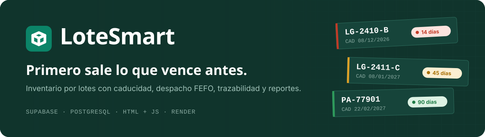
</p>

<p align="center">
  <a href="https://lotesmart.onrender.com"></a>
  
  
  
</p>

<p align="center">
  <b><a href="https://lotesmart.onrender.com">Abrir la app</a></b> ·
  <a href="#instalación-paso-a-paso">Instalación</a> ·
  <a href="#cómo-funciona-fefo">Cómo funciona FEFO</a> ·
  <a href="#base-de-datos">Base de datos</a> ·
  <a href="#roles-y-permisos">Roles</a>
</p>

---

## ¿Qué es LoteSmart?

**LoteSmart** es un sistema de inventario para negocios que venden productos con fecha de caducidad: abarrotes, lácteos, farmacias, cocinas. En lugar de contar "cuántas piezas hay", controla **cada lote** que entra, con su proveedor, su costo y su fecha de caducidad.

Con esa información resuelve tres problemas que en papel o en Excel son difíciles:

| Problema | Cómo lo resuelve LoteSmart |
|---|---|
| Se vende primero lo que llegó al último y lo viejo se echa a perder | Cada venta se surte sola con **FEFO** (*First Expired, First Out*): sale primero el lote que vence antes. |
| Nadie sabe cuánto dinero está por caducar | El **tablero** muestra el valor en riesgo, lo que ya no se puede vender y un semáforo por lote. |
| Hay un retiro sanitario y no se sabe a quién se le vendió | La **trazabilidad** dice en segundos qué clientes recibieron cada lote, con su teléfono. |

Es la versión web del documento técnico de LoteSmart (originalmente Java + MySQL), ahora con **PostgreSQL en Supabase** y publicada en **Render**.

<p align="center">
  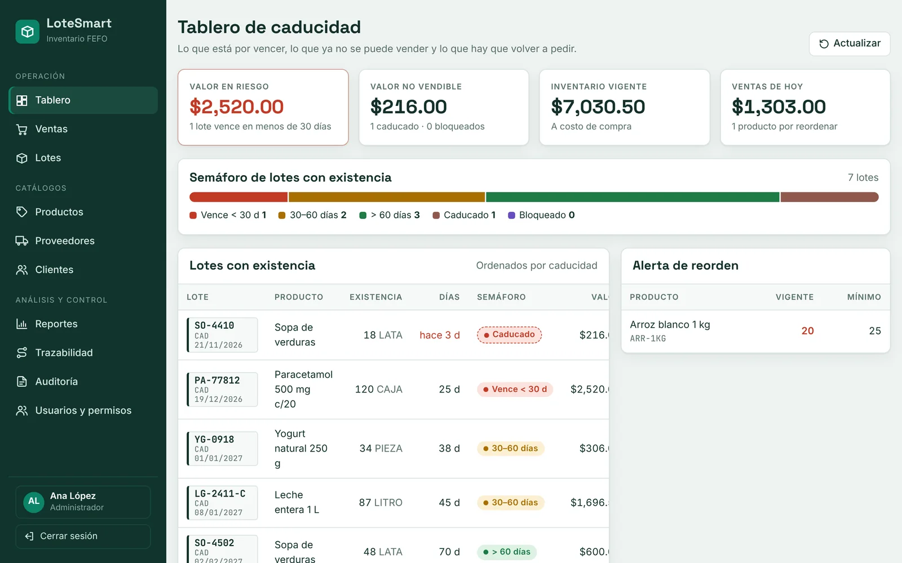
</p>

---

## Contenido

- [Funciones](#funciones)
- [Cómo funciona FEFO](#cómo-funciona-fefo)
- [Roles y permisos](#roles-y-permisos)
- [Arquitectura](#arquitectura)
- [Base de datos](#base-de-datos)
- [Seguridad](#seguridad)
- [Instalación paso a paso](#instalación-paso-a-paso)
- [Actualizaciones de la base de datos](#actualizaciones-de-la-base-de-datos)
- [Pruebas](#pruebas)
- [Estructura del proyecto](#estructura-del-proyecto)
- [Preguntas frecuentes](#preguntas-frecuentes)

---

## Funciones

### Operación diaria

| | |
|---|---|
| 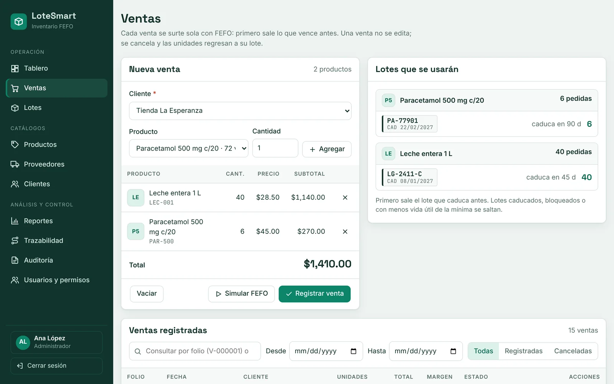 | **Ventas con FEFO**<br>Armas el carrito, pulsas **Simular FEFO** y ves de qué lote sale cada unidad antes de registrar. La venta se guarda completa o no se guarda (transacción). Una venta no se edita: se **cancela con motivo** y cada unidad regresa al lote exacto del que salió. |
| 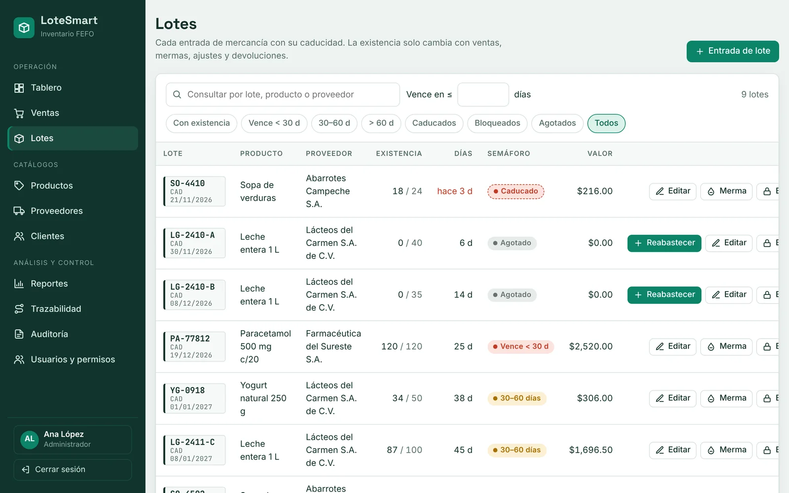 | **Lotes**<br>Cada entrada de mercancía es un lote con código, caducidad, cantidad y costo. Semáforo: **rojo** < 30 días, **amarillo** 30–60, **verde** > 60, más caducados, agotados y bloqueados. Desde aquí registras **mermas**, **ajustes** por conteo físico, **bloqueos** por retiro sanitario y **Reabastecer**, que llena solo el proveedor y el costo de la última entrada. |

### Catálogos (altas, bajas, modificaciones, listado y consulta)

- **Productos:** SKU, unidad de medida, precio, stock mínimo para la alerta de reorden, **vida útil mínima para vender** y **foto**. Botón **Recibir** para registrar mercancía nueva sin volver a capturar todo.
- **Proveedores:** RFC validado, razón social y teléfono.
- **Clientes:** nombre, RFC opcional, teléfono y correo.
- Las bajas son **lógicas** y reversibles. Un registro con historial no se borra: se da de baja.

### Análisis y control

| | |
|---|---|
| 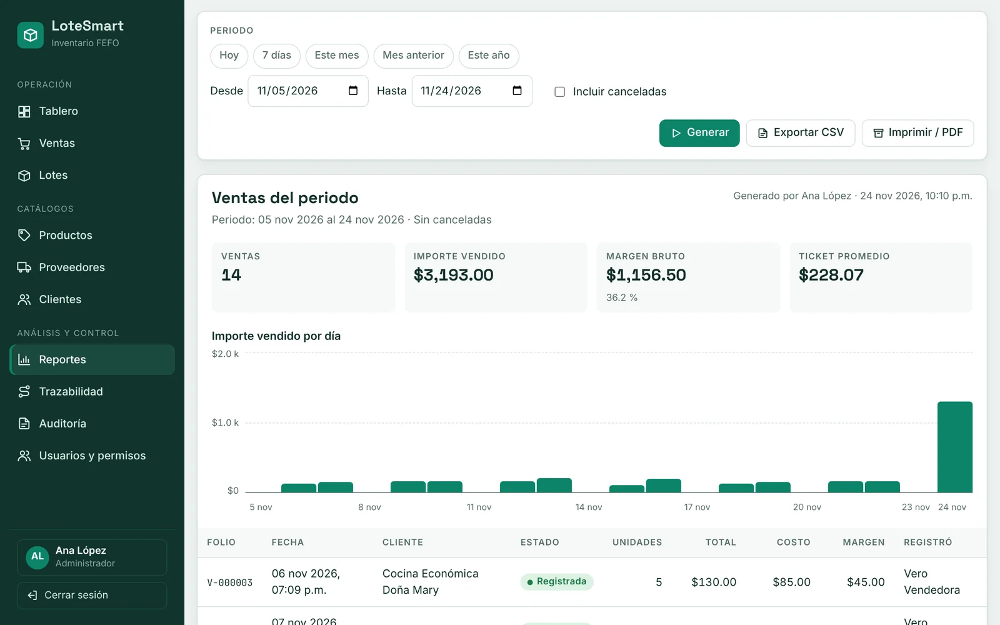 | **Reporteador** con 8 reportes, periodo libre, totales, gráfica, **Exportar CSV** (Excel) e **Imprimir / PDF**: ventas del periodo, ventas por producto, ventas por cliente, inventario valorizado, lotes por caducar, mermas y ajustes, entradas por proveedor y kárdex con saldo acumulado. |
| 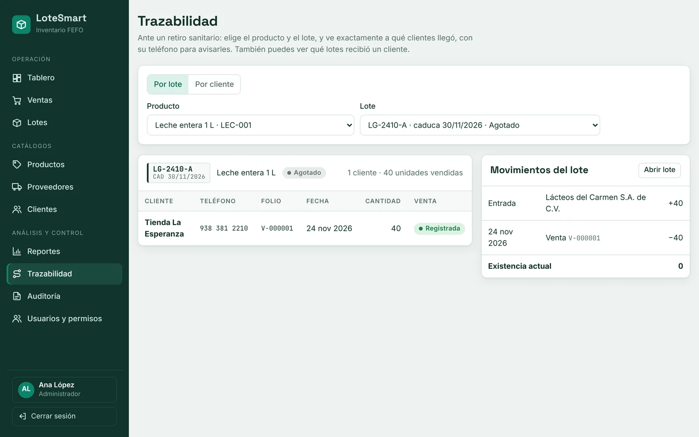 | **Trazabilidad** eligiendo producto y lote de una lista: a qué clientes llegó, cuántas unidades, con qué folio y teléfono. También al revés: qué lotes recibió un cliente. |
| 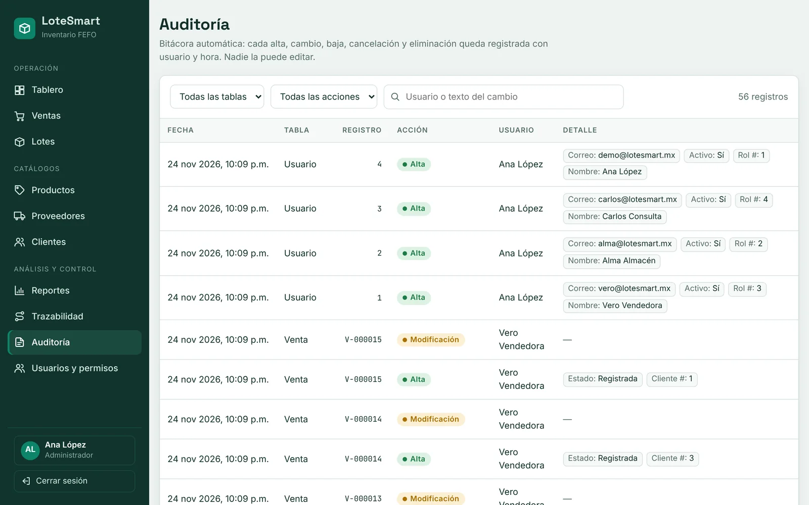 | **Auditoría automática**: cada alta, cambio, baja, cancelación y eliminación queda registrada con usuario y hora, con el antes y el después de cada campo. Nadie la puede editar. |
| 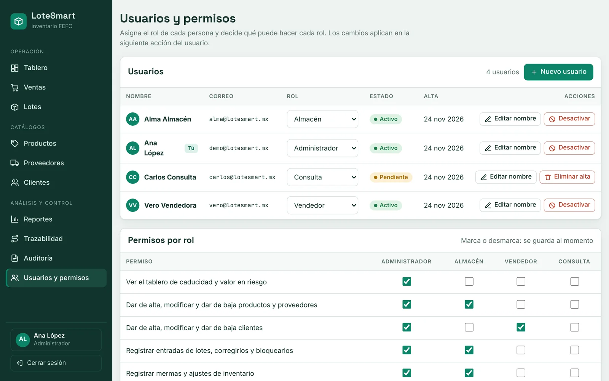 | **Usuarios y permisos**: el administrador da de alta a cada persona, le asigna un rol, la desactiva y decide con casillas qué puede hacer cada rol. |

### En cualquier pantalla

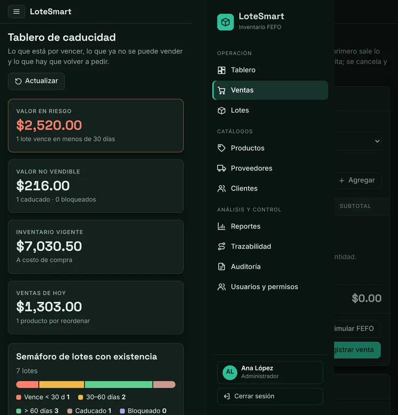

- **Inicio de sesión** con correo y contraseña (Supabase Auth), recuperación de contraseña y **Mi cuenta** para cambiar nombre y contraseña.
- Funciona en **computadora y celular**, en modo **claro y oscuro**.
- **Un solo archivo** (`index.html`): no hay que instalar nada ni compilar.
- Mensajes de error claros en español, por ejemplo: *"Existencia insuficiente de Paracetamol: se pidieron 90, hay 80 vendibles"*.

<br clear="right">

---

## Cómo funciona FEFO

Cuando se registra una venta, la base de datos busca los lotes **vigentes** del producto, los ordena por **fecha de caducidad** y va tomando unidades del primero hasta completar la cantidad. Los lotes se bloquean mientras se surte (`FOR UPDATE`), así dos ventas al mismo tiempo nunca venden la misma unidad.

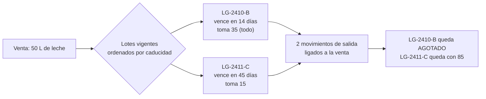

Reglas que aplica en cada venta:

- **Se saltan** los lotes caducados, bloqueados o agotados.
- **Vida útil mínima:** si un producto exige, por ejemplo, 30 días de vida, un lote que vence en 25 ya no se vende. Ejemplo de los datos de prueba: hay 200 cajas de Paracetamol, pero solo **80 vendibles**; pedir 90 se rechaza.
- **Todo o nada:** si un producto del carrito no alcanza, la venta completa se rechaza y no se mueve ninguna existencia.
- **Cancelar** una venta genera una devolución por cada lote usado: las unidades vuelven exactamente a donde estaban.

---

## Roles y permisos

Solo los **administradores** dan de alta usuarios (**Usuarios y permisos → Nuevo usuario**: nombre, correo, rol y contraseña temporal). La pantalla de inicio no tiene "Crear cuenta", y una cuenta que alguien registre por fuera no recibe acceso.

| Permiso | Administrador | Almacén | Vendedor | Consulta |
|---|:-:|:-:|:-:|:-:|
| Tablero de caducidad y valor en riesgo | ✅ | | | |
| Productos y proveedores (alta, cambios, baja) | ✅ | ✅ | | |
| Clientes (alta, cambios, baja) | ✅ | | ✅ | |
| Entradas de lotes, correcciones y bloqueos | ✅ | ✅ | | |
| Mermas y ajustes | ✅ | ✅ | | |
| Registrar ventas | ✅ | | ✅ | |
| Cancelar ventas | ✅ | | | |
| Eliminar registros definitivamente | ✅ | | | |
| Reportes | ✅ | ✅ | ✅ | ✅ |
| Auditoría | ✅ | | | |
| Usuarios y permisos | ✅ | | | |

- Todos pueden **consultar** catálogos, lotes, ventas y trazabilidad.
- Cada rol ve en el menú solo lo que puede usar y entra directo a su primera pantalla (el Vendedor llega a Ventas).
- Los permisos de cada rol se cambian con casillas, sin tocar código.
- Siempre debe quedar al menos un administrador activo.

---

## Arquitectura

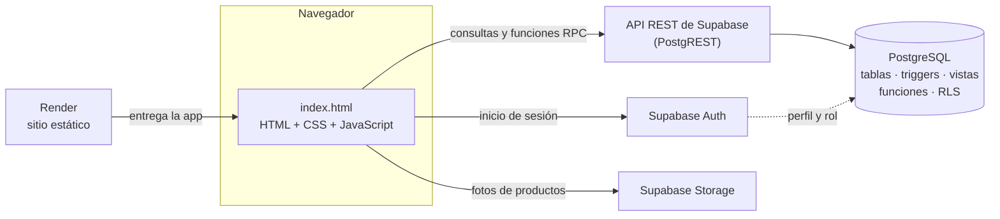

| Capa | Tecnología | Por qué |
|---|---|---|
| Interfaz | HTML, CSS y JavaScript sin frameworks | Un solo archivo, carga rápido y se publica en cualquier hosting. |
| Datos y reglas | PostgreSQL en Supabase | Las reglas de negocio viven en la base de datos: valen aunque alguien use SQL directo. |
| API | PostgREST de Supabase | Lecturas con vistas y escrituras con funciones RPC, sin servidor propio. |
| Sesiones | Supabase Auth | Correo y contraseña, recuperación por correo, tokens que se renuevan solos. |
| Fotos | Supabase Storage | Bucket público `productos`; la app reduce cada foto a 800 px antes de subirla. |
| Publicación | Render (sitio estático) | Gratis, se actualiza solo con cada cambio en `main`. |

---

## Base de datos

Diseño en **tercera forma normal (3FN)**. Cada catálogo vive en su tabla y los totales se **calculan**, no se guardan.

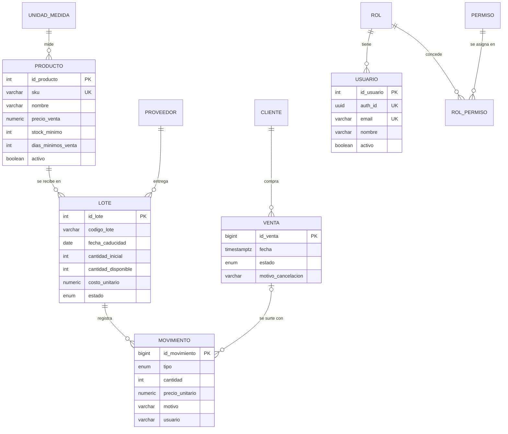

**Decisiones de normalización respecto al modelo original:**

- **cliente** es una tabla propia (antes era texto libre en la venta y el mismo cliente aparecía escrito de varias formas).
- **unidad_medida** es un catálogo (antes era texto libre).
- **El total de la venta no se guarda:** se calcula en la vista `v_venta_resumen` a partir de sus movimientos, así nunca puede descuadrar.
- `lote.cantidad_disponible` es la única redundancia, y es **controlada**: solo la cambia un trigger a partir de los movimientos; nadie la puede escribir a mano.
- Roles y permisos en tablas (`rol`, `permiso`, `rol_permiso`, `usuario`), no en el código.

<details>
<summary><b>Reglas de negocio que cumple la base de datos</b></summary>

<br>

| Regla | Cómo se garantiza |
|---|---|
| Despacho FEFO con vida útil mínima | Función `fn_fefo_asignar` con `FOR UPDATE` |
| Venta completa o nada | Una sola transacción en `venta_registrar` |
| Solo se vende de lotes vigentes y no vencidos | Trigger antes de insertar el movimiento |
| La existencia nunca es negativa ni mayor a lo recibido | `CHECK (cantidad_disponible BETWEEN 0 AND cantidad_inicial)` |
| La existencia no se edita a mano | Trigger que solo permite cambios desde movimientos |
| Lote nuevo con caducidad futura, producto y proveedor activos | Trigger antes de insertar el lote |
| Cantidad, costo y producto de un lote solo se corrigen si no tiene movimientos | Trigger antes de actualizar el lote |
| Los movimientos no se editan ni se borran | Triggers que lo rechazan |
| Las ventas no se borran; se cancelan una vez, con motivo | Triggers y `CHECK` en venta |
| Cancelar devuelve cada unidad a su lote | Movimientos `DEVOLUCION` en `venta_cancelar` |
| Mermas y ajustes llevan motivo | Trigger del movimiento |
| Lotes vencidos pasan a CADUCADO | `marcar_caducados()`, al entrar a la app (opcional: cada noche con `pg_cron`) |
| Códigos únicos (SKU, RFC, lote por producto) | Restricciones `UNIQUE` |
| Catálogos con historial no se borran | Triggers antes de eliminar + bajas lógicas |
| Todo queda auditado | Trigger genérico `trg_auditar` en cada tabla |
| Cada operación revisa el permiso del rol | `fn_exigir()` al inicio de cada función |

</details>

---

## Seguridad

- **Sin sesión no se ve nada:** el rol anónimo de Supabase no tiene permisos.
- **RLS activado** en todas las tablas: con sesión se puede leer; un usuario **desactivado** ya no ve ni registra nada.
- **Nadie escribe directo en las tablas:** todas las altas, cambios y ventas pasan por funciones que validan el permiso del rol y firman la operación.
- **La firma no se puede falsificar:** el nombre que queda en ventas y auditoría sale del perfil del usuario con sesión, no de lo que envíe el navegador.
- La clave que va en `index.html` es la **publishable / anon**, que es pública por diseño. **Nunca** pongas ahí la clave `secret` / `service_role`.

---

## Instalación paso a paso

> Tiempo aproximado: 10 minutos. Solo necesitas una cuenta gratuita de Supabase y otra de Render.

### 1. Base de datos en Supabase

1. Crea un proyecto en [supabase.com](https://supabase.com).
2. Abre **SQL Editor → New query**, pega todo [`sql/lotesmart_supabase.sql`](sql/lotesmart_supabase.sql) y pulsa **Run**.
   Esto crea las tablas, reglas, reportes, roles y datos de prueba.
   > ⚠️ Ese script **reinicia** los datos de LoteSmart si lo vuelves a ejecutar. Para actualizar una instalación que ya tiene datos, usa las [actualizaciones](#actualizaciones-de-la-base-de-datos).
3. Crea **tu usuario administrador** en **Authentication → Users → Add user → Create new user**, con correo, contraseña y la casilla *Auto Confirm User*. La primera cuenta de la instalación queda como **Administrador**.
4. En **Project Settings → API** copia la **Project URL** y la clave **publishable** (o *anon public*).

### 2. Conectar la app

Abre `index.html` y escribe tus datos al inicio del `<script>`:

```js
const CONFIG = {
  url: "https://TU-PROYECTO.supabase.co",
  anonKey: "sb_publishable_..."
};
```

Si los dejas vacíos, la app los pide la primera vez que se abre.

### 3. Publicar en Render

1. Sube el proyecto a un repositorio de GitHub.
2. En [Render](https://dashboard.render.com): **New → Blueprint →** elige el repositorio **→ Deploy Blueprint**.
   El archivo [`render.yaml`](render.yaml) crea un sitio estático gratuito que se actualiza solo con cada cambio en `main`.
3. Copia el link que te da Render (por ejemplo `https://lotesmart.onrender.com`) y pégalo en Supabase → **Authentication → URL Configuration → Site URL**, y en **Redirect URLs** agrega el mismo link con `/**` al final. Así funcionan los correos de confirmación y de recuperar contraseña.

### 4. Dar de alta al equipo

Entra como administrador y ve a **Usuarios y permisos → Nuevo usuario**. La app te muestra los datos de acceso para compartirlos.

> 💡 Para una demo rápida, desactiva *Confirm email* en **Authentication → Sign In / Providers → Email**: así las cuentas quedan listas al momento. **No** desactives *Allow new users to sign up*: la app lo usa para crear las cuentas que da de alta el administrador.

---

## Actualizaciones de la base de datos

Si instalaste una versión anterior y ya tienes datos, ejecuta en orden las actualizaciones que te falten. **Ninguna borra datos** y todas se pueden volver a ejecutar sin problema.

| Archivo | Qué agrega |
|---|---|
| [`actualizacion_01_auditoria.sql`](sql/actualizacion_01_auditoria.sql) | Auditoría legible (campo: valor en lugar de JSON). |
| [`actualizacion_02_imagenes.sql`](sql/actualizacion_02_imagenes.sql) | Fotos de productos: columna, función y bucket de Storage. |
| [`actualizacion_03_roles.sql`](sql/actualizacion_03_roles.sql) | Roles de usuario y permisos. |
| [`actualizacion_04_tablero.sql`](sql/actualizacion_04_tablero.sql) | El tablero solo lo ve el Administrador. |
| [`actualizacion_05_alta_usuarios.sql`](sql/actualizacion_05_alta_usuarios.sql) | Solo los administradores dan de alta usuarios. |

---

## Pruebas

[`tests/pruebas.sql`](tests/pruebas.sql) contiene **57 pruebas automáticas** de la base de datos: reglas de negocio, FEFO, cancelaciones, seguridad, roles, alta de usuarios y reportes. Ejecútalo en el SQL Editor después de instalar; debe terminar con:

```
57 de 57 aprobadas
```

> Las pruebas modifican los datos de prueba. Al terminar, vuelve a ejecutar `lotesmart_supabase.sql` en un proyecto de pruebas, no en el de producción.

---

## Estructura del proyecto

```
LoteSmart/
├── index.html                       # La aplicación completa (interfaz y lógica)
├── render.yaml                      # Publicación en Render como sitio estático
├── sql/
│   ├── lotesmart_supabase.sql       # Instalación completa de la base de datos
│   └── actualizacion_01 … 05.sql    # Actualizaciones que no borran datos
├── tests/
│   └── pruebas.sql                  # 57 pruebas automáticas
└── docs/
    ├── banner.svg                   # Encabezado de este README
    └── img/                         # Capturas de pantalla
```

---

## Preguntas frecuentes

<details>
<summary><b>¿Por qué no puedo editar la existencia de un lote?</b></summary>
<br>
Para que el inventario siempre cuadre con su historial. La existencia solo cambia con ventas, mermas, ajustes y devoluciones, y cada uno queda registrado con usuario, hora y motivo. Si el conteo físico no coincide, usa <b>Ajuste</b>.
</details>

<details>
<summary><b>Me volvió a llegar un producto que se había agotado. ¿Lo doy de alta otra vez?</b></summary>
<br>
No. En <b>Productos</b> pulsa <b>Recibir</b>, o en <b>Lotes</b> pulsa <b>Reabastecer</b>. El proveedor y el costo se llenan solos con los de la última entrada; solo escribes el código del lote nuevo, su caducidad y la cantidad. Se crea un lote nuevo porque cada lote tiene su propia caducidad.
</details>

<details>
<summary><b>¿Qué pasa si cancelo una venta?</b></summary>
<br>
La venta queda marcada como cancelada con su motivo (no se borra) y cada unidad regresa al lote exacto del que salió. En trazabilidad aparece en gris.
</details>

<details>
<summary><b>¿Por qué el stock de un producto bajó si no hubo ventas?</b></summary>
<br>
El "stock vigente" solo cuenta lotes que se pueden vender. Si un lote caducó o se bloqueó, deja de contarse aunque las unidades sigan en bodega. Esas unidades aparecen en el tablero como "valor no vendible".
</details>

<details>
<summary><b>Alguien creó una cuenta por su lado y no puede entrar.</b></summary>
<br>
Es lo esperado: solo entra quien dio de alta un administrador. Dale de alta en <b>Usuarios y permisos → Nuevo usuario</b> con el mismo correo y su cuenta quedará ligada.
</details>

<details>
<summary><b>Los cambios no aparecen en la página publicada.</b></summary>
<br>
Recarga con <b>Ctrl + F5</b>. Si sigue igual, en Render entra al servicio <b>lotesmart → Manual Deploy → Deploy latest commit</b>.
</details>

---

<p align="center">
  Hecho por <a href="https://github.com/MARCOXD18414">@MARCOXD18414</a> · LoteSmart · 2026
</p>
